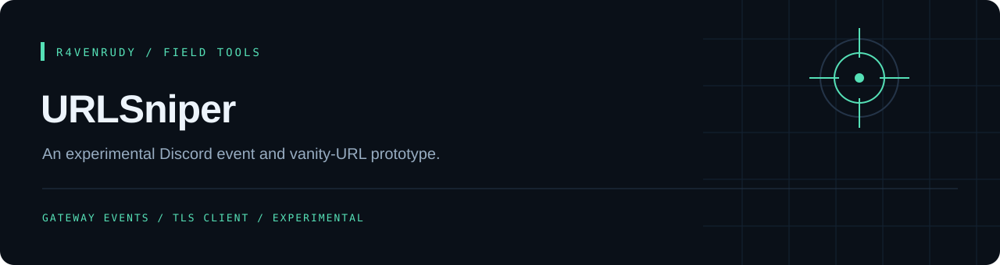

<p align="center"></p>

<p align="center">
  
  
  <a href="LICENSE"></a>
</p>

<p align="center"><strong>An experimental Discord event and vanity-URL prototype.</strong></p>

<p align="center"><a href="#overview">Overview</a> · <a href="#capabilities">Capabilities</a> · <a href="#quick-start">Quick start</a> · <a href="#implementation-notes">Implementation notes</a></p>

---

## Overview

An experimental Discord gateway listener with a TLS request client and a separate Go authentication helper. The source reacts to guild events and attempts state-changing vanity-URL updates; this is an automation prototype, not a passive URL resolver.

## Capabilities

| Component | What the source contains |
| :--- | :--- |
| `indext.js` | Gateway event handling, TLS connection management and vanity-update requests |
| `mfa.go` | Authentication helper that writes a local token file |
| Configuration | Local account/server/channel settings and a socket-count setting |
| Launchers | Windows batch files for the JavaScript and Go components |

## Quick start

Start with a **source review in an isolated development environment**. There is no package manifest or validated installation workflow in this repository. The JavaScript imports `ws` and `extract-json-from-string` in addition to Node.js built-ins; the Go helper uses the Go standard library.

```bash
git clone https://github.com/r4venrudy/URLSniper.git
cd URLSniper
```

Review `indext.js`, `mfa.go` and the launchers before running anything. The file is named `indext.js`, not `index.js`. Existing configuration and authentication files must not be copied into shared examples.

## Implementation notes

- The TLS client currently sets `rejectUnauthorized: false`, so server certificate verification is disabled in this prototype.
- Credential-like values are committed in the authentication/configuration files. Treat those values as exposed; revoke or rotate any that remain valid before further use. Removing values from the latest revision alone does not remove them from Git history.
- The source makes state-changing requests to Discord and uses account/MFA-related flows. Review account ownership, platform requirements and the effect of each request before any authorized experiment.
- No benchmark in this repository establishes sub-millisecond execution, guaranteed acquisition or production reliability. These claims are intentionally absent from this documentation.
- This README update documents the existing source. It does not validate the automation, repair the authentication design or certify platform compatibility.

## Project map

```text
indext.js      JavaScript event and request prototype
mfa.go         Go authentication helper
config.json    Local configuration; treat committed values as exposed
mfa.json       Local token data; treat committed values as exposed
*.bat          Windows launchers
```

## License

[MIT](LICENSE). Preserve the attribution in the license file.

---

<p align="center">Part of the <a href="https://github.com/r4venrudy">r4venrudy</a> project collection.</p>
